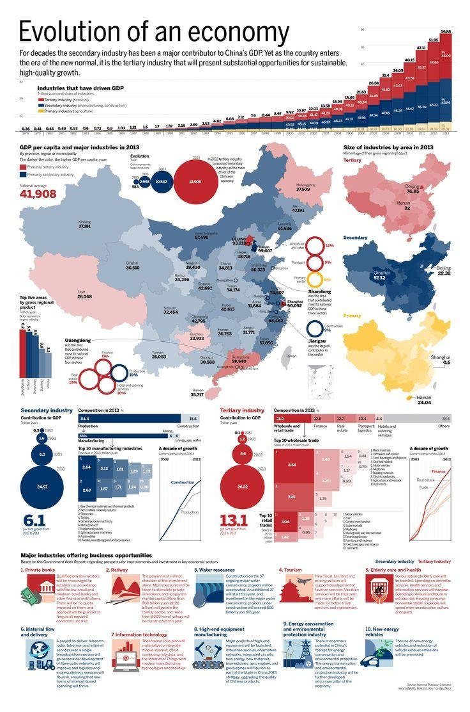

# Evolution of an Economy

来源为《第三讲－信息图形类型学》第 66 页。原作标题无法可靠识读时使用描述性案名。图像为课件摘录，原作权利属于相应权利人。

## 01 主数据逻辑

[编年型](../../../01-信息图形数据逻辑/01-编年型信息图形概念定义.md)。顺序、时期或步骤是主索引。本图可识读记录以「模块」及其关系拆解。

## 02 表现标签

[编年编目复合型](../README.md)。阶段顺序与类别共同组织图面。

## 特性、视觉编码与叙事

顶部累积视觉建立进程，地图和下方模块把变化拆到地区和主题。

## 制作方法与流程

1. 建立时间序列及对应地区、行业键。
2. 统一经济指标单位。
3. 先画时序再汇入地图和分项。

## 基础数据与信息结构

[下载基础数据集（CSV）](基础数据集.csv)。本表记录可辨认的条目、关系或图形构件。源表未随课件提供，无法可靠识读的数值待核验。每行记录一项观测，每列存一个字段。

| 模块 | 图面要素 | 来源页 | 证据类型 |
| --- | --- | --- | --- |
| 经济时序 | 顶部面积图 | 66 | 结构观察 |
| 区域分布 | 地图 | 66 | 结构观察 |
| 主题细节 | 底部模块 | 66 | 结构观察 |
