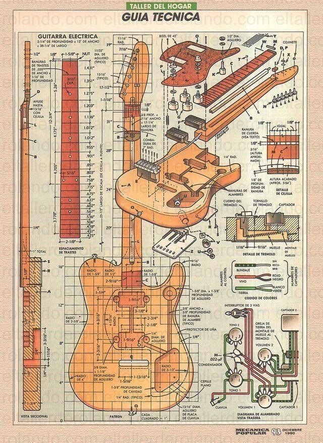

# 电吉他构造技术图

来源为《第三讲－信息图形类型学》第 13 页。原作标题无法可靠识读时使用描述性案名。图像为课件摘录，原作权利属于相应权利人。

## 01 主数据逻辑

[层级型](../../../01-信息图形数据逻辑/02-层级型信息图形概念定义.md)。按父子、部分与整体或从属层次检索。本图可识读记录以「部件」及其关系拆解。

## 02 表现标签

[解剖型信息图形](../README.md)。主体、局部详图和引线解释构造。

## 特性、视觉编码与叙事

正视轮廓和局部技术详图分别呈现部件及电路，线条引导读者从整体看到构件。

## 制作方法与流程

1. 建立整琴、部件和细节图关联。
2. 按正视图拆出局部。
3. 统一编号、方向与尺寸标注。

## 基础数据与信息结构

[下载基础数据集（CSV）](基础数据集.csv)。本表记录可辨认的条目、关系或图形构件。源表未随课件提供，无法可靠识读的数值待核验。每行记录一项观测，每列存一个字段。

| 部件 | 图面表达 | 来源页 | 证据类型 |
| --- | --- | --- | --- |
| 琴颈 | 条形详图 | 13 | 结构观察 |
| 琴体 | 外形图 | 13 | 结构观察 |
| 电路 | 示意图 | 13 | 结构观察 |
