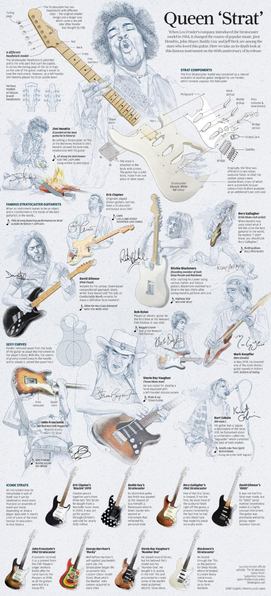

# Queen Strat吉他图解

来源为《第三讲－信息图形类型学》第 14 页。原作标题无法可靠识读时使用描述性案名。图像为课件摘录，原作权利属于相应权利人。

## 01 主数据逻辑

[编目型](../../../01-信息图形数据逻辑/03-编目型信息图形概念定义.md)。按主体条目、属性或类别比较。本图可识读记录以「部件」及其关系拆解。

## 02 表现标签

[解剖型信息图形](../README.md)。主体、局部详图和引线解释构造。

## 特性、视觉编码与叙事

斜向分解图把安装关系串起来，周边细节补充零件，底部排列同类器材。

## 制作方法与流程

1. 以部件表串起分解步骤和标签位置。
2. 单独建型号目录。
3. 最终检查零件引线归属。

## 基础数据与信息结构

[下载基础数据集（CSV）](基础数据集.csv)。本表记录可辨认的条目、关系或图形构件。源表未随课件提供，无法可靠识读的数值待核验。每行记录一项观测，每列存一个字段。

| 部件 | 图面表达 | 来源页 | 证据类型 |
| --- | --- | --- | --- |
| 琴颈 | 分解示意 | 14 | 结构观察 |
| 琴体 | 局部放大 | 14 | 结构观察 |
| 吉他系列 | 底部缩略图 | 14 | 结构观察 |
