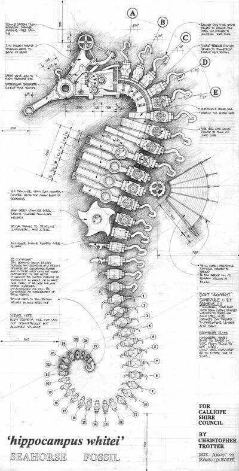

# 海马解剖图

来源为《第三讲－信息图形类型学》第 33 页。原作标题无法可靠识读时使用描述性案名。图像为课件摘录，原作权利属于相应权利人。

## 01 主数据逻辑

[层级型](../../../01-信息图形数据逻辑/02-层级型信息图形概念定义.md)。按父子、部分与整体或从属层次检索。本图可识读记录以「部位」及其关系拆解。

## 02 表现标签

[解剖型信息图形](../README.md)。主体、局部详图和引线解释构造。

## 特性、视觉编码与叙事

主体轮廓居中，编号和引线连接各部位，细密线描提示构造。

## 制作方法与流程

1. 建立部位编号表。
2. 描绘整体外形再绘组织细节。
3. 沿外围安排说明并核验位置。

## 基础数据与信息结构

[下载基础数据集（CSV）](基础数据集.csv)。本表记录可辨认的条目、关系或图形构件。源表未随课件提供，无法可靠识读的数值待核验。每行记录一项观测，每列存一个字段。

| 部位 | 图面要素 | 来源页 | 证据类型 |
| --- | --- | --- | --- |
| 头部 | 局部标注 | 33 | 结构观察 |
| 躯干 | 结构线 | 33 | 结构观察 |
| 尾部 | 形态轮廓 | 33 | 结构观察 |
