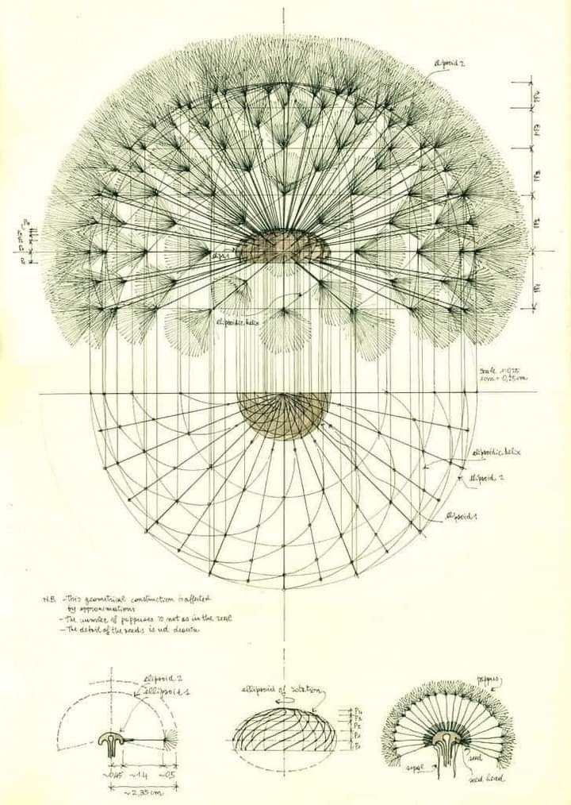

# 花序结构手绘解剖

来源为《第三讲－信息图形类型学》第 64 页。原作标题无法可靠识读时使用描述性案名。图像为课件摘录，原作权利属于相应权利人。

## 01 主数据逻辑

[层级型](../../../01-信息图形数据逻辑/02-层级型信息图形概念定义.md)。按父子、部分与整体或从属层次检索。本图可识读记录以「部件」及其关系拆解。

## 02 表现标签

[解剖型信息图形](../README.md)。主体、局部详图和引线解释构造。

## 特性、视觉编码与叙事

放射线描揭示分支关系，底部局部图供读者交叉验证细节。

## 制作方法与流程

1. 记录分支层级与部件索引。
2. 绘主轮廓、枝线和局部视图并核对标注。

## 基础数据与信息结构

[下载基础数据集（CSV）](基础数据集.csv)。本表记录可辨认的条目、关系或图形构件。源表未随课件提供，无法可靠识读的数值待核验。每行记录一项观测，每列存一个字段。

| 部件 | 图面表达 | 来源页 | 证据类型 |
| --- | --- | --- | --- |
| 花序 | 总览 | 64 | 结构观察 |
| 分支 | 细线 | 64 | 结构观察 |
| 局部结构 | 小剖图 | 64 | 结构观察 |
