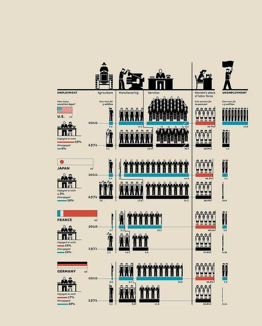

# ISOTYPE多行社会统计

来源为《第三讲－信息图形类型学》第 59 页。原作标题无法可靠识读时使用描述性案名。图像为课件摘录，原作权利属于相应权利人。

## 01 主数据逻辑

[编目型](../../01-信息图形数据逻辑/03-编目型信息图形概念定义.md)。按主体条目、属性或类别比较。本图可识读记录以「记录对象」及其关系拆解。

## 02 表现标签

[单一图表型信息图形](../../02-信息图形类型案例/单一图表型信息图形/README.md)。用一张主要图形支撑读数或评估。

设计方法：[ISOTYPE](../README.md)。

## 特性、视觉编码与叙事

整齐的图符队列使读者横比组别和数量，色块把并列指标分开。

## 制作方法与流程

1. 确认不同组的单符号单位后。
2. 按计数生成重复图符。
3. 检查不同面板是否共用比例。

## 基础数据与信息结构

[下载基础数据集（CSV）](基础数据集.csv)。本表记录可辨认的条目、关系或图形构件。源表未随课件提供，无法可靠识读的数值待核验。每行记录一项观测，每列存一个字段。

| 记录对象 | 图面要素 | 来源页 | 证据类型 |
| --- | --- | --- | --- |
| 群组 | 横行 | 59 | 结构观察 |
| 数量 | 重复符号 | 59 | 结构观察 |
| 对照 | 颜色 | 59 | 结构观察 |
