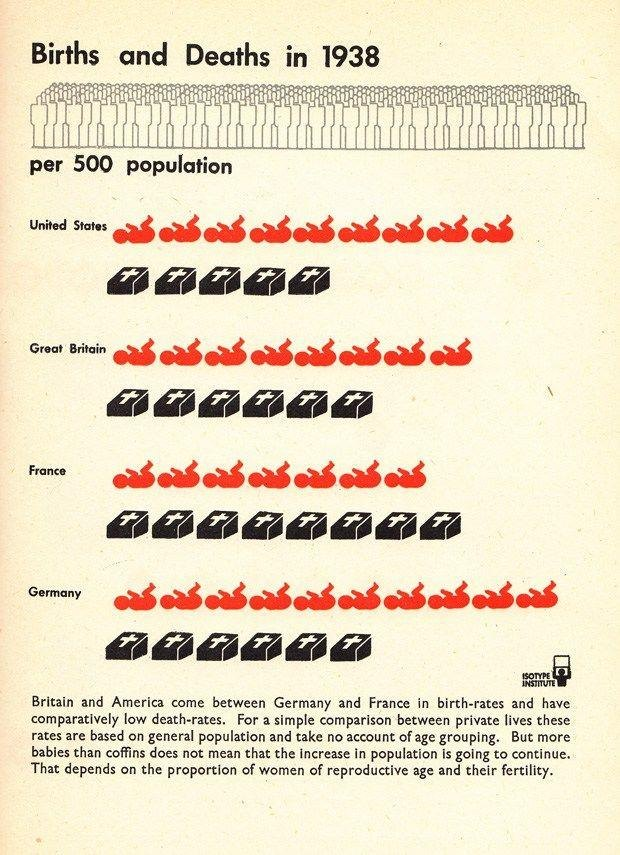

# 1938年出生与死亡比较

来源为《第三讲－信息图形类型学》第 61 页。原作标题无法可靠识读时使用描述性案名。图像为课件摘录，原作权利属于相应权利人。

## 01 主数据逻辑

[编目型](../../01-信息图形数据逻辑/03-编目型信息图形概念定义.md)。按主体条目、属性或类别比较。本图可识读记录以「国家」及其关系拆解。

## 02 表现标签

[比较型信息图形](../../02-信息图形类型案例/比较型信息图形/README.md)。同尺度或并置呈现支撑对照。

设计方法：[ISOTYPE](../README.md)。

## 特性、视觉编码与叙事

每国两行图符表示出生与死亡，红与黑区分指标，图例以每 500 人提供共同口径。

## 制作方法与流程

1. 整理国家、指标、发生数和人口分母。
2. 换算为每 500 人后用同尺寸符号排列并复核图例。

## 基础数据与信息结构

[下载基础数据集（CSV）](基础数据集.csv)。本表记录图面可辨认的数值、时间或索引，空白表示未可靠辨认。每行记录一项观测，每列存一个字段。

| 国家 | 系列 | 年份 | 来源页 | 证据类型 |
| --- | --- | --- | --- | --- |
| 美国 | 出生和死亡 | 1938 | 61 | 图面转录 |
| 英国 | 出生和死亡 | 1938 | 61 | 图面转录 |
| 法国 | 出生和死亡 | 1938 | 61 | 图面转录 |
| 德国 | 出生和死亡 | 1938 | 61 | 图面转录 |
