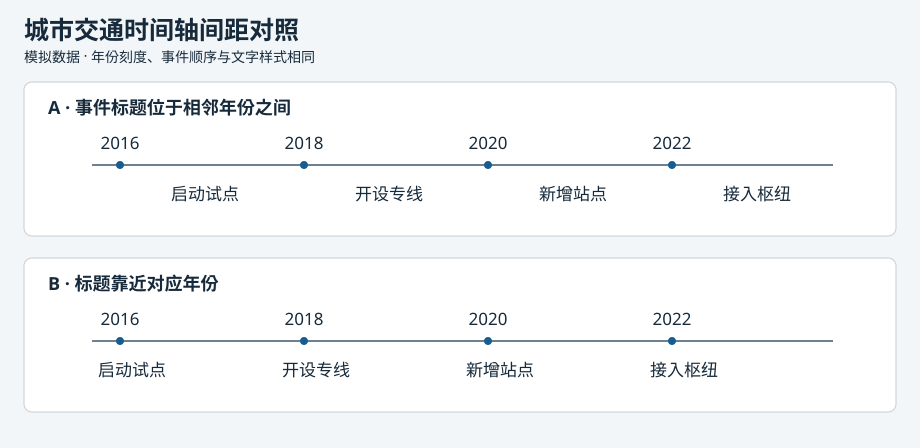

# 城市交通时间轴间距对照

- 主数据逻辑为[编年型](../../../01-信息图形数据逻辑/01-编年型信息图形概念定义.md)。
- 主表现标签为[时间轴型](../../../02-信息图形类型案例/时间轴型信息图形/README.md)。
- 主知觉线索为[接近律](../../原则与概念/01-接近律.md)。图和数据为原创教学示例。
- [基础数据集 CSV](基础数据集.csv)

| 年份 | 事件 |
| --- | --- |
| 2016 | 启动试点 |
| 2018 | 开设专线 |
| 2020 | 新增站点 |
| 2022 | 接入枢纽 |

## 图形特性、统计与信息架构

每条记录对应一个事件和一个年份。按年份排列，图中每两年的刻度间隔固定为 184 个 SVG 坐标单位。文档保留模拟事件的来源和证据类型。比例时间轴承载事件顺序与年份间隔，标题与节点的距离提示标签归属。

## 视觉编码与叙事

点定位时点，轴线建立从早到晚的阅读方向，文字说明事件。两版使用相同的顺序、颜色与字体。A 版将标题中心从所属刻度向右偏移 85 个坐标单位，标题位置接近两个年份的中点。B 版将偏移缩小到 12 个坐标单位，让读者更容易以相同的从左向右顺序将年份与标题配对。

## 制作方法和流程

1. 录入四条事件，按年份排序。
2. 绘制轴线、点位及年份标签，再复制为两个版面。
3. 在两个版面分别设置事件标题的横向偏移，保留其他布局变量。
4. 导出为 SVG，在桌面和窄屏分别检查标签位置、重叠及可读性。

## 实践检验

设计预期是 B 版的日期与事件配对更清楚。可让读者在两种版式中配对四条记录，记录错误数、位置与用时。若同一读者看两个版本，交替版本顺序以减少先看版本带来的记忆影响。以上为图面观察和待验证的设计预期，尚未进行读者测试。
